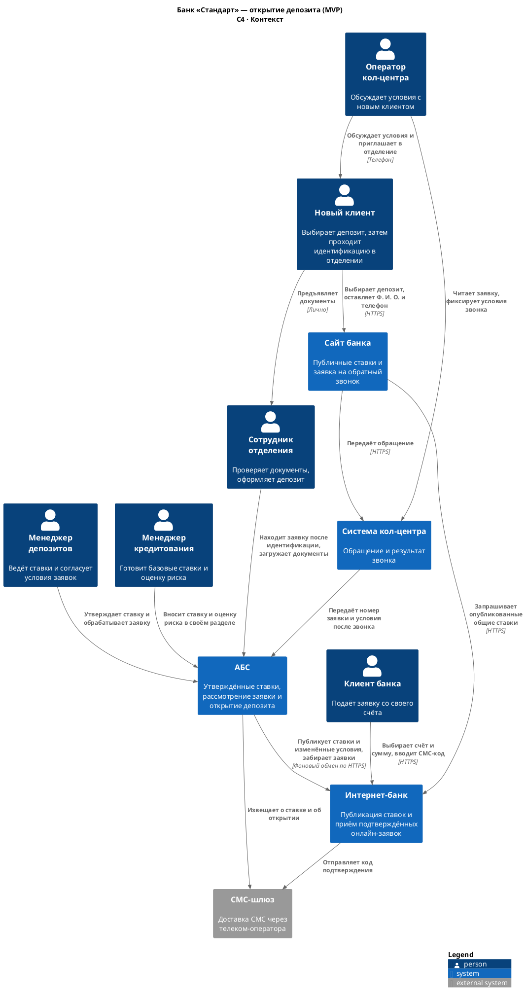
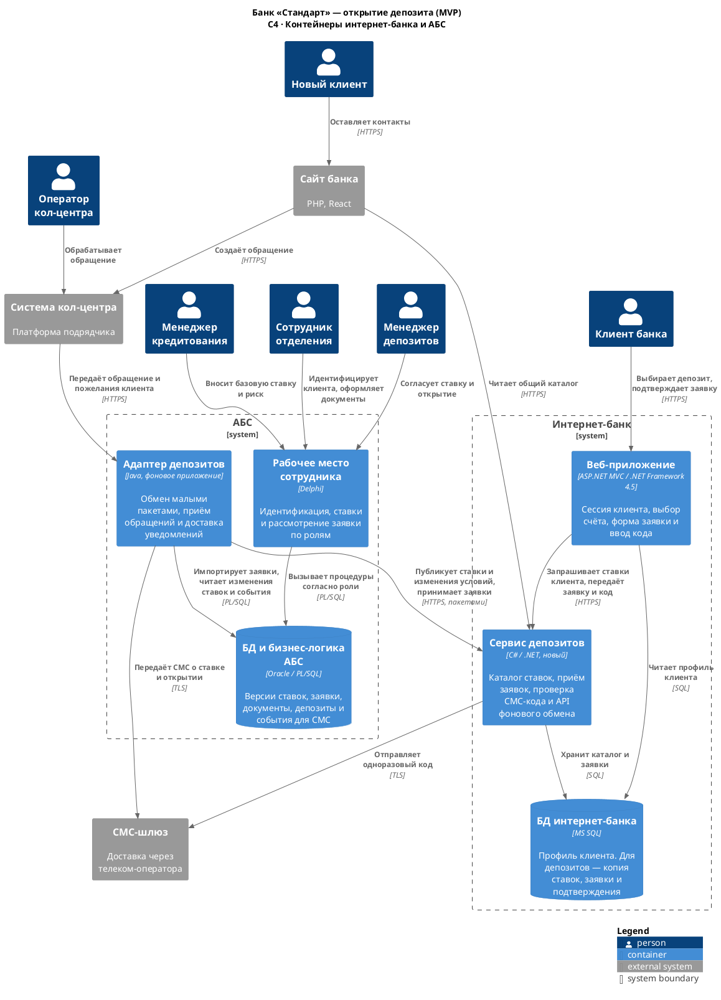

### **Название задачи:** Открытие депозита через сайт и интернет-банк. Архитектура MVP

### **Автор:** Команда цифровой трансформации банка «Стандарт»

### **Дата:** 20.11.2026

### **Функциональные требования**

| **№** | **Действующие лица или системы** | **Use Case** | **Описание** |
| :-: | :- | :- | :- |
| UC1 | Кредитный и депозитный бэк-офисы, АБС, сервис депозитов | Опубликовать ставки (F3) | 1. Менеджер кредитования в своём разделе АБС вводит базовую ставку и, при необходимости, оценку риска клиента. 2. Менеджер депозитов утверждает общие или персональные условия и срок их действия. 3. АБС передаёт сервису депозитов новую версию условий. Кредитные данные остаются в АБС. |
| UC2 | Новый клиент, сайт, система кол-центра, оператор, АБС | Подать заявку с сайта (F1) | 1. Клиент выбирает депозит по опубликованной общей ставке и оставляет Ф. И. О. и телефон. 2. Сайт передаёт обращение в систему кол-центра и подтверждает приём после его регистрации. 3. Оператор звонит клиенту, обсуждает обычные или особые условия и приглашает в отделение. 4. Система кол-центра передаёт обращение в АБС для согласования. |
| UC3 | Действующий клиент, интернет-банк, СМС-шлюз | Подать заявку в интернет-банке (F2) | 1. После входа клиент видит общие и свои персональные ставки. 2. Выбирает предложение, счёт списания и сумму. 3. Получает СМС-код и вводит его в интернет-банке. 4. После успешной проверки клиент получает номер заявки. Заявка доступна бэк-офису для обработки после фоновой передачи в АБС. |
| UC4 | Депозитный бэк-офис, АБС, СМС-шлюз | Согласовать ставку по заявке (F3, F4) | 1. Менеджер в АБС проверяет заявку и утверждает условия с учётом доступной ему оценки риска. 2. АБС фиксирует ставку и инициирует первое уведомление клиенту. 3. Если условия отличаются от подтверждённых клиентом, банк получает его согласие на новые условия до открытия. |
| UC5 | Клиент, сотрудник отделения, депозитный бэк-офис, АБС, СМС-шлюз | Открыть депозит (F1, F4) | 1. Нового клиента сотрудник идентифицирует в отделении, находит обращение по номеру и прикладывает подписанные документы. Действующий клиент подтверждает условия в интернет-банке. 2. После проверки условий и счёта уполномоченный сотрудник проводит открытие в АБС. 3. По факту открытия АБС инициирует второе СМС. |

### **Нефункциональные требования**

| **№** | **Требование** |
| :-: | :- |
| U1, P1 | Сохранить дизайн-систему банка. Каталог и форма должны отвечать за миллисекунды. Точный предел, процентиль и пиковую нагрузку нужно согласовать до нагрузочного теста. Ручная обработка заявки измеряется отдельно. |
| R1, P4 | Целевая доступность сервисов — 99,9% при работе 24/7. Резервный ЦОД должен выдерживать рабочую нагрузку после переключения. Распределять запросы между экземплярами сервиса депозитов. АБС масштабируется вертикально. |
| R2 | Повтор после обрыва связи возвращает ранее принятый результат. Одна заявка может породить только один депозит. |
| +R1, F3 | Шифровать передачу контактов, реквизитов, ставок и кодов. Публичному сайту доступны только общие ставки, клиенту после входа — только его предложения и счета. Сохранить границы доступа двух бэк-офисов. |
| +R2, +R4–+R6 | Ограничить обращения к перегруженной Oracle. Использовать знакомые банку технологии и сохранить ядро платформы подрядчика. Учитывать несовместимость действующего интернет-банка с Kafka. |
| S1, S2 | Описать контракты обмена, статусы и ответственные команды. По номеру заявки поддержка должна различать задержку передачи, ожидание решения сотрудника и сбой отправки СМС. |

### **Решение**

АБС хранит утверждённые ставки и принимает окончательное решение об открытии депозита. Для онлайн-каналов команда интернет-банка выделяет один **сервис депозитов**. Он отдаёт ставки из локальной копии в MS SQL и принимает подтверждённые заявки. Так просмотр каталога и ожидание решения менеджера не создают синхронной нагрузки на Oracle.

**Ставки и каналы.** При переходе с XLS бэк-офис сверяет действующие ставки и заносит их в АБС. Каждая опубликованная версия содержит продукт, ставку, период действия и, для персонального предложения, идентификатор клиента. Сервер сайта запрашивает только общий каталог. Веб-приложение интернет-банка использует существующую сессию и передаёт сервису идентификатор вошедшего клиента. Для выбора счёта предполагается переиспользовать перечень счетов из действующего платёжного интерфейса. Команда интернет-банка проверит, что его можно получить без дополнительного запроса в АБС при открытии формы. При истечении срока предложения сервис прекращает приём заявок по нему до обновления условий.

**Заявка и согласие клиента.** Сайт отправляет контакты в систему кол-центра по HTTPS. Для одного обращения сайт, кол-центр и АБС используют один номер. При повторной отправке система кол-центра возвращает уже зарегистрированное обращение. В интернет-банке сервис депозитов сам запрашивает отправку кода на подтверждённый номер клиента через существующий СМС-шлюз. Одноразовый код с ограниченным сроком действия привязан к заявке, счёту, сумме и версии условий. Сервис проверяет код и сохраняет подтверждение в MS SQL одной транзакцией. Изменение условий требует нового подтверждения. Ядро монолита остаётся в ведении подрядчика.

**Обмен с АБС.** Новый адаптер на стороне АБС обслуживает существующий маршрут обращений из кол-центра и периодически вызывает внутренний HTTPS API сервиса депозитов. Он публикует изменившиеся ставки и забирает подтверждённые заявки небольшими пакетами. Если менеджер изменил условия конкретной заявки, адаптер публикует предложение с её номером и новой версией. Клиент видит его в интернет-банке и подтверждает повторно. Адаптер возвращает согласие в АБС по тому же номеру заявки. Адаптер подтверждает приём только после записи в Oracle. Уникальный номер заявки в обеих системах и связь депозита с этим номером защищают от дублей при повторе. Размер пакета и интервал выбирает команда АБС по результатам замера нагрузки. Для MVP достаточно этого обмена и двух существующих СУБД.

**Открытие и уведомления.** Менеджеры работают через клиент Delphi в пределах своих ролей. Перед открытием процедуры АБС проверяют согласие на итоговые условия, идентификацию, принадлежность счёта и доступную сумму. АБС сохраняет смену статуса и запись для отправки СМС в одной транзакции Oracle. Адаптер последовательно отправляет уведомления о согласованной ставке и состоявшемся открытии через шлюз. Сбой доставки оставляет запись для повтора и виден поддержке по номеру заявки.

**Команды и границы работ**

| Команда | Что меняет или проверяет |
| --- | --- |
| Команда сайта | Каталог и форму на PHP/React, передачу обращения в систему кол-центра, обработку повтора. |
| Команда интернет-банка | Форму в ASP.NET MVC, сервис депозитов на C#, хранение в MS SQL, подтверждение по СМС и API обмена. Уточняет с подрядчиком доступные точки расширения монолита. |
| Команда АБС | Рабочие места Delphi, ролевые операции PL/SQL в Oracle, адаптер обмена и уведомлений. Вместе с обоими бэк-офисами сверяет ставки и проверяет сценарий спецусловий. |
| Команда сопровождения кол-центра у подрядчика | Регистрацию обращения с сайта, экран оператора и передачу результата звонка в АБС. |
| ИТ-эксплуатация банка и владелец СМС-шлюза | Доступ к шлюзу с проверкой сервиса-отправителя, контроль очереди заявок и доставки СМС, балансировку и испытание переключения ЦОД. |

### **Альтернативы**

- **Синхронные запросы из каналов в АБС.** Дают самую свежую ставку, но каждый просмотр каталога увеличивает нагрузку на Oracle. Сбой АБС блокирует даже просмотр предложений.
- **Kafka для обмена ставками и заявками.** Полезна при росте числа потребителей. Для двух каналов в MVP пакетный обмен проще в сопровождении, а прямой клиент Kafka несовместим с текущей платформой интернет-банка.
- **Доработка СМС-модуля в ядре интернет-банка.** Позволяет переиспользовать механизм подрядчика, но ставит сроки MVP в зависимость от его релиза. В выбранном варианте команда банка отвечает за привязку кода к операции и ограничение попыток ввода.

**Недостатки, ограничения, риски**

- Ставка меняется в АБС раньше, чем обновляется копия. Заявка сохраняет показанную версию. АБС проверяет её перед открытием. Если условия изменились, действующий клиент подтверждает обновлённое предложение новым кодом, а новый — в отделении.
- Ручная проверка сохраняет очередь бэк-офиса. Приём заявки можно подтвердить сразу, срок фактического открытия зависит от загрузки сотрудников.
- Пакетная обработка сглаживает нагрузку на АБС, но увеличивает задержку. Эксплуатация контролирует возраст последней публикации ставок, самой старой необработанной заявки и неотправленного СМС. При длительном сбое публикации приём по устаревшему каталогу приостанавливается.
