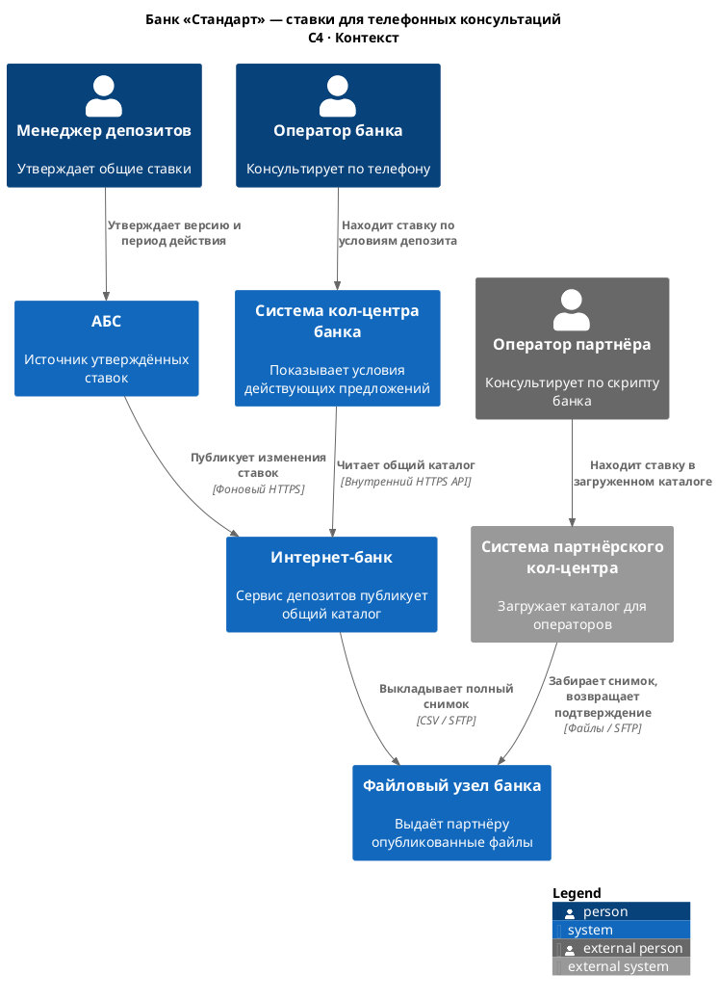
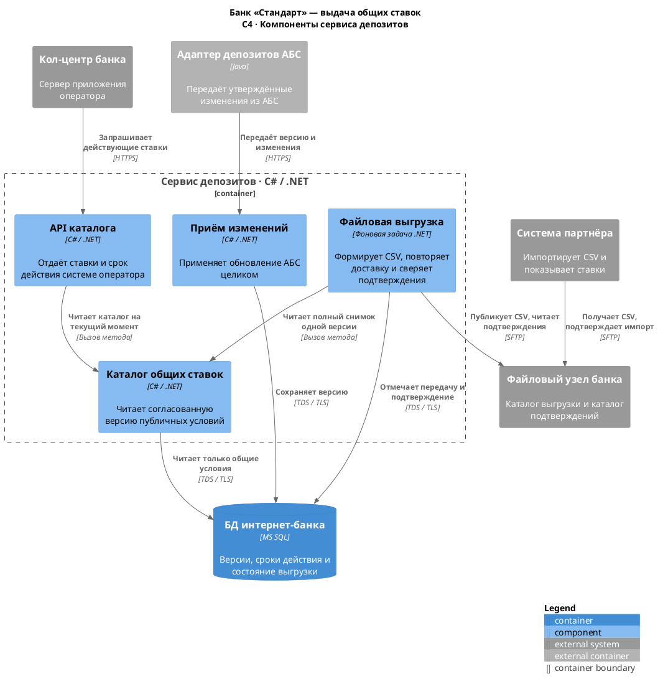

### **Название задачи:** Передача общих ставок по депозитам в кол-центры банка и партнёра

### **Автор:** Команда цифровой трансформации банка «Стандарт»

### **Дата:** 23.11.2026

### **Функциональные требования**

| **№** | **Действующие лица или системы** | **Use Case** | **Описание** |
| :-: | :- | :- | :- |
| UC1 | Кредитный и депозитный бэк-офисы, АБС, сервис депозитов | Опубликовать ставки | 1. Кредитный отдел рассчитывает ставки. 2. Менеджер депозитов утверждает в АБС общие условия и дату их вступления в силу. 3. Адаптер АБС публикует изменения в сервисе депозитов. Утверждение новой ставки или отзыв прежней запускает обновление каталога. |
| UC2 | Клиент, оператор и система кол-центра банка | Проконсультировать клиента банка | 1. Клиент звонит и называет интересующие его сумму и срок. 2. Оператор открывает каталог в своей системе, выбирает продукт, валюту, сумму и срок. 3. Система получает подходящие действующие условия, оператор озвучивает ставку. Индивидуальные условия согласуются по существующей заявке. |
| UC3 | Сервис депозитов, файловый узел, система партнёра | Передать ставки партнёру | 1. Банк публикует файл с полной версией общего каталога. 2. Система партнёра забирает его, проверяет формат и номер версии. 3. После успешной загрузки она заменяет каталог целиком и возвращает банку подтверждение с номером версии. Новая версия может также снять продукт с продажи. |
| UC4 | Клиент, оператор и система партнёрского кол-центра | Ответить на звонок у партнёра | 1. Оператор следует скрипту банка и находит предложение в локальном каталоге. 2. Система показывает ставку и условия, действующие на момент звонка. 3. Если актуальных данных нет или клиенту нужны индивидуальные условия, оператор направляет его в кол-центр банка. |

### **Нефункциональные требования**

| **№** | **Требование** |
| :-: | :- |
| N1 | Для одной версии каталога оба кол-центра показывают одинаковые общие условия и сроки их действия. Персональные предложения, клиентские данные и сведения о кредитном риске остаются за пределами консультационного каталога. |
| N2 | Звонки и скачивания файлов не создают запросов в Oracle АБС. Проверку нагрузки перед кампанией проводят на прогнозном пике звонков. Для банковских сервисов действует цель из задания 2 — 24/7 и доступность 99,9%. |
| N3 | Обмен внутри банка идёт по HTTPS с авторизацией системы кол-центра. Партнёр обменивается файлами по SFTP с отдельной учётной записью и SSH-ключом. Читать выгрузки и записывать подтверждения можно только в выделенных каталогах. |
| N4 | Оба оператора должны видеть, что актуальная ставка недоступна, если истёк срок предложения или срок свежести каталога. Частичный импорт, дубликат и запоздалый файл не должны подменять действующую версию. |
| N5 | Банк отслеживает последнюю публикацию в АБС, версию в сервисе депозитов и последнюю версию, которую импортировал партнёр. Предельную задержку от утверждения до показа и срок ожидания подтверждения банк согласует с партнёром в М1. |

### **Решение**

Используем каталог сервиса депозитов из [задания 3](../Task3/ADR.md). Сейчас сотрудники ежедневно обмениваются расчётами в Excel. При переходе на MVP бэк-офис сверяет исходные ставки с XLS и утверждает их в АБС. Дальше адаптер АБС передаёт версии в MS SQL сервиса депозитов. Обоим кол-центрам доступны только общие условия. Экран банковского оператора и файл партнёра формируются из одной выборки.

**Кол-центр банка.** Сервер системы кол-центра читает общий каталог по внутреннему HTTPS API. Экран оператора показывает продукт, диапазон суммы, валюту, срок, ставку и период её действия. При недоступности актуальных данных система предлагает зарегистрировать обратный звонок.

**Партнёрский кол-центр.** После каждой публикации и при ежедневном обновлении банк выкладывает полный снимок в CSV UTF-8. Имя файла содержит возрастающий номер версии и время окончания её актуальности. Каждая строка содержит код и название продукта, валюту, границы суммы и срока, годовую ставку и период её действия. Время обмена фиксируется в одном согласованном часовом поясе. Пустой снимок с корректным заголовком означает, что действующих предложений нет. Ежедневная публикация подтверждает актуальность каталога даже при прежних ставках.

Сервис сначала пишет временный файл на SFTP-узел банка, затем переименовывает его в готовый. Партнёр периодически забирает готовые файлы, проверяет их и применяет только более новую версию одной транзакцией. После импорта он оставляет файл подтверждения. Если подтверждение потерялось, партнёр повторяет его для уже принятой версии. Если файл испорчен, партнёр сохраняет предыдущую версию до истечения её срока. Банк видит задержку и повторяет выдачу. Период опроса и срок свежести должны укладываться в согласованную задержку N5.

### **Альтернативы**

- **Выдавать обоим кол-центрам ставки через API АБС.** Даёт доступ к первоисточнику при каждом запросе, но поток звонков увеличит нагрузку на Oracle. Кроме того, партнёр принимает данные только файлами.
- **Рассылать текущий XLS по почте.** Это быстрее организовать вручную. Однако рабочая книга может содержать внутренние расчёты, а банк не увидит, какую версию открыли операторы и отозвали ли старую ставку.

**Недостатки, ограничения, риски**

- Между изменением ставки и импортом файла у партнёра есть задержка. Особенно важен отзыв ставки в течение дня. На приёмке банк снимает предложение и измеряет время до его исчезновения с обоих экранов.
- Возможность партнёра читать SFTP и возвращать подтверждение файлом — проектное допущение. До разработки команды проверяют обмен тестовыми файлами и согласуют формат с партнёром.
- Готовность банковских сервисов сама по себе не гарантирует доступность внешней системы. До начала кампании партнёр проверяет работу под ожидаемой нагрузкой и обучает операторов сценарию с устаревшими данными.

[Крупные задачи и зависимости](tasks.md) · [Дорожная карта на 12 месяцев](roadmap.drawio)
