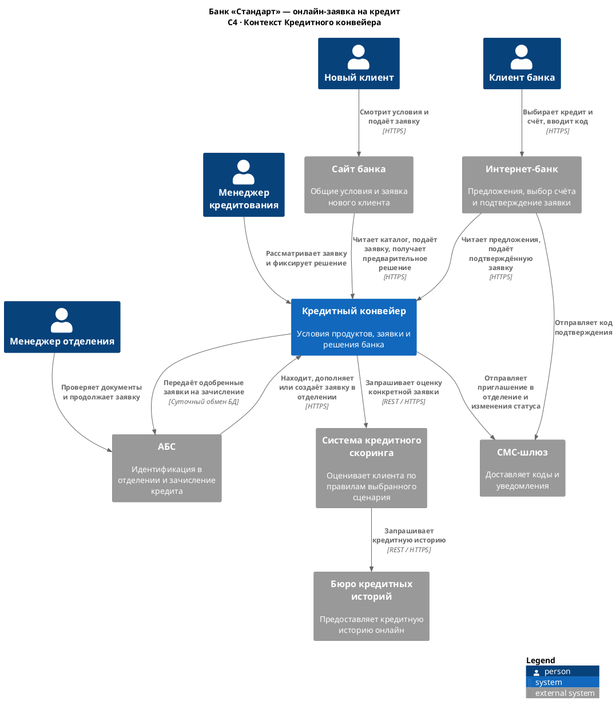
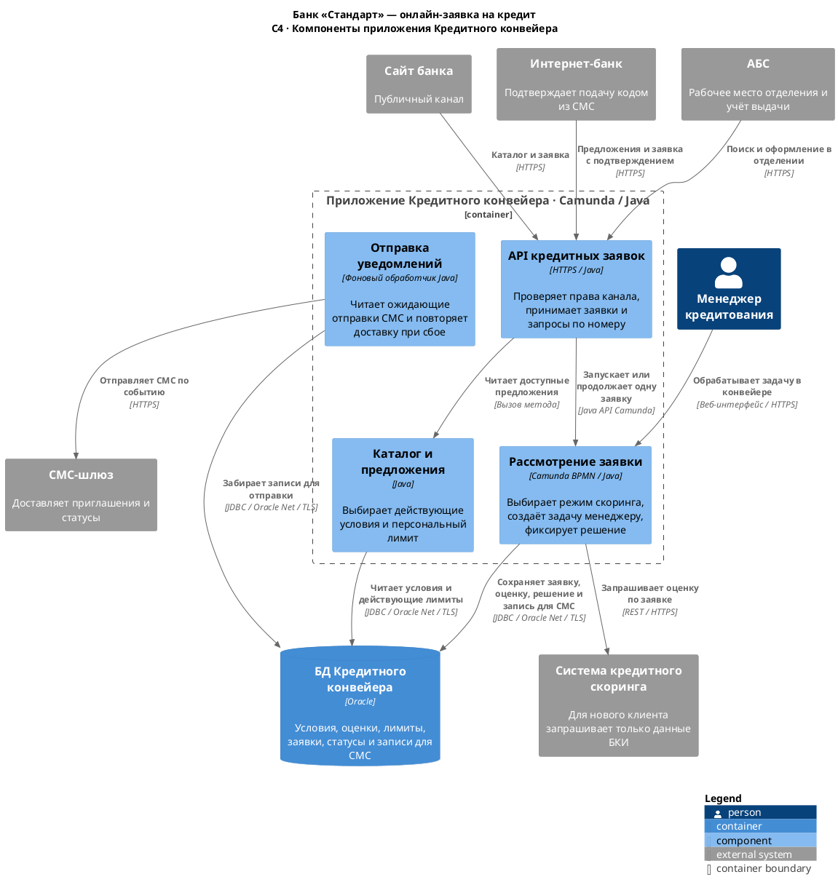

### **Название задачи:** Онлайн-заявка на кредит с сайта и из интернет-банка

### **Автор:** Команда цифровой трансформации банка «Стандарт»

### **Дата:** 23.11.2026

Горизонт реализации — один год после запуска MVP. Кредитный конвейер ведёт заявку с момента подачи до решения банка. Клиент может начать оформление на сайте и продолжить его в отделении под тем же номером.

### **Функциональные требования**

| **№** | **Действующие лица или системы** | **Use Case** | **Описание** |
| :-: | :- | :- | :- |
| UC1 · F5 | Клиент, сайт, интернет-банк, Кредитный конвейер | Выбрать кредит | 1. Канал получает из конвейера опубликованные продукты, ставки и сроки их действия. 2. Клиент видит актуальные условия. 3. После входа в интернет-банк клиент также видит своё действующее предодобренное предложение с суммой, если оно есть. |
| UC2 · F5, F6 | Новый клиент, сайт, конвейер, СМС-шлюз | Оставить заявку без паспорта | 1. Клиент выбирает продукт и вводит Ф. И. О. и телефон. 2. Конвейер регистрирует заявку, сайт показывает её номер. 3. Клиент получает СМС с приглашением в отделение для идентификации и дальнейшего оформления. |
| UC3 · F6 | Новый клиент, сайт, конвейер, скоринг, БКИ | Получить предварительное решение на сайте | 1. Клиент дополнительно заполняет паспортные данные. 2. Конвейер сохраняет заявку и сразу запрашивает скоринг только по сведениям БКИ. 3. При доступности оценки сайт в том же сеансе показывает предварительное одобрение или отказ. 4. Текст СМС учитывает результат. При предварительном одобрении клиент получает приглашение для идентификации и получения кредита. |
| UC4 · F7 | Клиент, менеджер отделения, АБС, конвейер | Продолжить или начать заявку в отделении | 1. Менеджер проверяет документы и находит заявку в АБС по её номеру. 2. АБС запрашивает карточку в конвейере. После сверки личности менеджер дополняет ту же заявку, сохраняя предварительное решение. 3. Если после поиска заявки нет, менеджер создаёт новую через АБС. |
| UC5 · F8 | Действующий клиент, интернет-банк, конвейер, СМС-шлюз | Подать заявку из интернет-банка | 1. Клиент выбирает общее или предодобренное предложение, указывает сумму, счёт зачисления и данные заявки. 2. Подтверждает отправку кодом из СМС на проверенный номер. 3. Интернет-банк передаёт подтверждённую заявку в конвейер и показывает её номер. |
| UC6 · F8, F9 | Конвейер, скоринг, менеджер кредитования, АБС, СМС-шлюз | Принять решение и уведомить клиента | 1. Для обычной заявки конвейер запрашивает стандартную оценку. Для предодобренной проверяет сохранённый результат и при изменениях запрашивает упрощённую оценку. 2. Менеджер рассматривает заявку и фиксирует итоговое решение. 3. При изменении клиентского статуса конвейер инициирует СМС. 4. Одобренная заявка передаётся в АБС для зачисления по действующему суточному расписанию. |

### **Нефункциональные требования**

Коды приведены по [таблице FURPS+](../Task2/FURPS+.md).

| **№** | **Требование** |
| :-: | :- |
| P2, +R3 | При достаточных данных клиент любого онлайн-канала должен получить решение в течение дня. Заявку по предодобренному предложению сотрудники обрабатывают в тот же рабочий день. Частота обмена между БД АБС и конвейера остаётся прежней. |
| P1, U1 | Каталог и формы должны отвечать за миллисекунды и использовать дизайн-систему банка. Задержку интерфейса, время онлайн-скоринга с БКИ и время решения сотрудника измеряют отдельно. Численные пороги для нагрузочной проверки согласуют до запуска. |
| P3, P4 | Предрасчёт предложений не создаёт дополнительной нагрузки на действующий скоринг. Конвейер и скоринг поддерживают горизонтальное масштабирование. Нагрузку на каждый из них проверяют с учётом пика онлайн-заявок. |
| R1, R2 | Цель для онлайн-пути — 24/7 и доступность 99,9%, в том числе при переключении ЦОД. Повтор отправки или переход в отделение сохраняет номер принятой заявки. |
| +R1, +R2, +R4–+R6 | Передача данных защищена TLS. Публичный канал получает только общие условия и результат своей заявки. Персональные предложения и счета доступны владельцу после входа. Интернет-банк обращается к API конвейера. Сохраняются ограничения Oracle АБС и ядра интернет-банка. |
| S1, S2 | Команды документируют контракты, переходы статусов, правила повторов и сроки обработки. По номеру заявки поддержка различает ожидание БКИ, очередь менеджера и задержку отправки СМС. Паспортные данные и СМС-коды в диагностические журналы не попадают. |

### **Решение**

Серверы сайта, интернет-банка и рабочее место АБС обращаются к **единому API Кредитного конвейера**. Конвейер уже хранит условия продуктов и предоставляет сотрудникам рабочее место для рассмотрения заявок. Приём онлайн-заявки через API позволяет сразу создать задачу в Camunda. Суточный обмен с АБС сохраняется для учёта и выдачи кредита.

**Условия и предодобрение.** Сайт и интернет-банк могут кэшировать общие предложения в пределах срока действия опубликованной версии. При подаче конвейер проверяет выбранную версию. Для персонального предложения используются результат ранее выполненного скоринга клиента, допустимый лимит и срок действия решения. Если лимит не сохранён, конвейер может вывести его из действующей оценки по согласованным кредитным правилам. Открытие каталога не вызывает скоринг. Клиент без пригодной оценки видит общие предложения.

**Два режима оценки.** Для посетителя сайта с паспортом скоринг обращается к БКИ онлайн. Для действующего клиента применяется обычный процесс, который уже использует клиентские данные и платежи из суточных выгрузок. По предодобренному предложению Camunda сравнивает сумму с лимитом и проверяет срок и исходные данные оценки. Изменение значимых данных запускает упрощённую проверку по конкретной заявке. Критерии изменения и достаточности оценки задаёт кредитный отдел. Если данных мало, менеджер получает задачу на дополнительную проверку.

**Одна заявка во всех каналах.** Конвейер сохраняет заявку в своей Oracle до ответа каналу. Повтор с тем же ключом подачи возвращает прежний номер. В отделении номер служит для поиска. Доступ к продолжению заявки сотрудник получает после сверки личности. Если номера нет, сотрудник может выполнить поиск по проверенным данным. Совпадения телефона недостаточно для объединения заявок. На сайте результат связан с сеансом подачи. Один номер заявки не даёт посетителю доступ к её данным. Для заявок, зарегистрированных через API, АБС сохраняет номер конвейера, чтобы суточная выгрузка не создала второй процесс. При повторном импорте решения тот же номер защищает от повторной выдачи.

**СМС и обработка в срок.** Команда интернет-банка расширяет механизм подтверждения из депозитного MVP на операцию подачи кредитной заявки. Одноразовый код привязан к конкретным условиям, сумме и счёту. Конвейер принимает подтверждение от авторизованного сервера банка. При смене статуса Camunda в одной транзакции сохраняет статус и запись для отправки СМС. Фоновый обработчик доставляет приглашения и уведомления через существующий шлюз. Предодобренные заявки попадают в приоритетную очередь менеджеров сразу после приёма. Для контроля срока видны время поступления и возраст самой старой заявки.

### **Альтернативы**

- **Принимать все заявки в АБС и ждать суточной выгрузки.** Переиспользует существующий путь отделения, но заявка, поданная сразу после выгрузки, почти сутки не попадёт к менеджеру. Увеличить частоту обмена нельзя.
- **Запрашивать скоринг при каждом входе в интернет-банк.** Так можно предлагать кредит большему числу клиентов с новой оценкой. Однако просмотры каталога создадут нагрузку на рабочий скоринг даже у клиентов, которые не собираются подавать заявку.
- **Вынести ведение онлайн-заявок в отдельную систему.** Это отделит каналы от конвейера, но потребует синхронизировать две карточки заявки, статусы и решения. Для трёх каналов достаточно расширения существующего приложения на Java и Camunda.

**Недостатки, ограничения, риски**

- При тайм-ауте скоринга или БКИ сайт показывает номер принятой заявки и статус «На рассмотрении». Конвейер повторяет запрос по той же заявке. Технический сбой не превращается в кредитный отказ. Мгновенное предварительное решение зависит от доступности БКИ.
- Часть внутренних данных обновляется раз в сутки. Срок действия предодобрения и допустимый возраст исходных данных кредитный отдел должен установить до запуска. При недостаточном покрытии сохранёнными оценками меньше клиентов увидят персональное предложение.
- Срок решения зависит и от графика сотрудников. До запуска банк согласует порядок обработки поздних и выходных заявок и проверит очередь на пиковой нагрузке. Зачисление после одобрения может прийтись на следующий цикл обмена с АБС.
- Для повторного использования СМС-подтверждения нужно проверить, позволяет ли реализация MVP привязать код к кредитной операции. Цель доступности требует испытания интернет-банка в резервном ЦОД под нагрузкой. Сбой шлюза задерживает подтверждение новой заявки или доставку сообщения о принятом решении.
